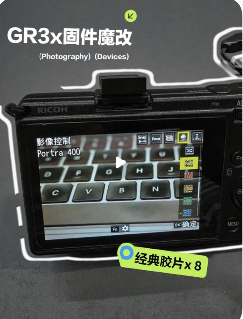
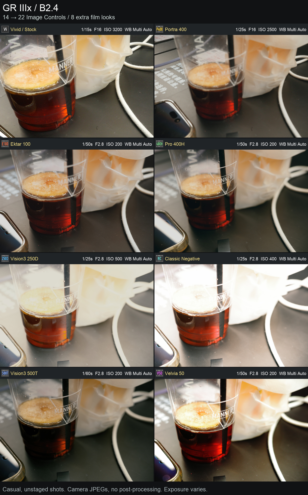
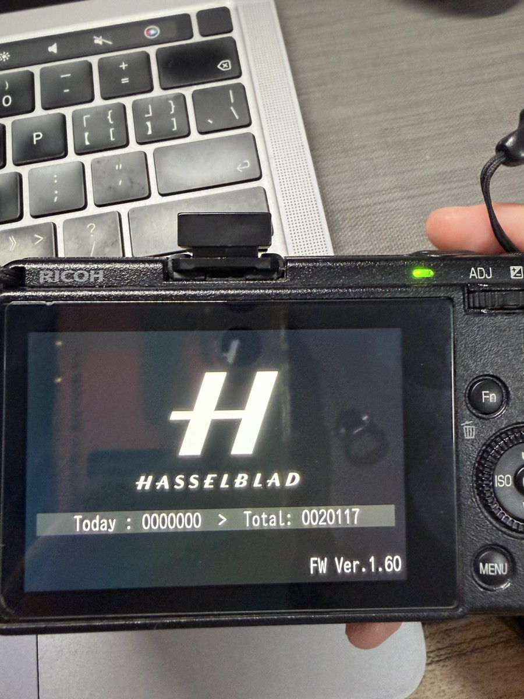

# gr3x-fw-play

## 2026-10-23 更新：转用插件路线

### 安装教程

1. 先把相机刷回原厂 GR IIIx 1.60。
   - 刷回原厂会清除旧 B2.4.x 固件里的改动（新增预设、图标/比例等）；需要这些效果只能刷回 B2.4.x，不能和插件版共存。
2. 下载 [GRPlay 插件版 v0.2](https://github.com/tinyblckc0000al/gr3x-fw-play/releases/tag/plugin-v0.2)，解压后把包放到 SD 卡根目录。
3. 关机，按住 MENU 再按电源，等 Complete 自动关机。
4. 正常开机，等待30s-60s。
5. 看指示灯连续闪烁后，按adj键，正常的话可以看到加的功能菜单。

PS：
- 新方案不依赖 B2.4.x 固件；B2.4.x 和插件版不能同时存在
（B2.4.2 追加 blob 是 0x540B55C0..0x540C9604，GRKit 追加区域是 0x540B6000..0x540BE000，两者有重叠）
- B2.4.x 仍可单独刷回使用，旧包继续保留，不覆盖、不删除。

### 比项目之前的固件（B2.4.x）多了什么

- 9:16/3:4/xpan拍摄比例、构图辅助线、日期戳、颗粒等功能；
- 柔焦五档、柔光四档，Fn 滑杆调整；
- 18 套机内胶片效果（包括之前的 8 套预设）；
- 菜单按键交互优化；
- 安装时恢复原厂 Clarity 表，不需要修改原厂固件。

### 方案来源和优势

采用 [GRKit v1.0.0](https://github.com/ahonn/grkit) 的启动基底：

- Linux 侧 TTL/Script 安装器，通过 /dev/mem 写私有尾部；
- RTOS 侧固定尾部、私有 ADJ 菜单、picture.encode 链；
- SD 包、构建/校验、按插件启停。

方案优势：
- 不刷固件，恢复代价低；
- 复用原厂 RTOS 菜单、图像处理和 JPEG 编码；
- 固定尾部 + 少量 hook，改动面小；
- 插件可单独启停、回滚，便于逐步上机；
- Linux 已有文件系统、eMMC 和脚本入口。

### 放弃的其他方案

#### 为什么不再改固件

B2.4.x 直接修改固件，和版本、存储布局绑定；每次升级都要重适配，写 flash 后恢复也不可控。
插件路线不改固件，通过 SD 卡安装，重启即恢复；功能可逐项测试、单独回退。

放弃了 B2.4.x 的 patch 层和修改后的 RTOS 镜像。复用了B2.4.x 方案：
- 8 套预设的曲线/矩阵/参数；
- 图像处理、存储布局和 effect 校验经验；
- 安装、回滚和真机验证流程。

直接改 RTOS 的尝试包括：B2.4.x 固件镜像、预设槽、图标、存储布局，以及 clarity/参数和 internal storage 调用。
完整替换 RTOS 需要大量逐版本逆向，失败后恢复路径不可控；原厂 RTOS 已提供菜单和图像处理，替换收益低。

最终方案：
- Linux 负责安装、文件系统和回滚；
- RTOS 只挂菜单和 picture.encode 等必要 hook；
- 图像处理仍走原厂 RTOS。

#### 为什么暂不做内置存储持久化

原厂 I: 有文件服务，但安装阶段直接调用会中断；创建/截断/追加、掉电同步、路径边界也未验证。
直接写有丢照片或破坏系统区的风险。当前设置仍在 RAM，重启归零；优先做 SD 配置，内置存储只做受控探针。

### 可能待优化（maybe）

- [ ] 重启持久化
- [x] 原生菜单体验优化（v0.2）
- [x] 柔光、柔焦优化（v0.2）
- [ ] gr2色彩

## 之前的固件版（B2.4.2）

> **B2.4.2 存储修复：** 新增配方与补丁代码迁入独立追加区，恢复原厂补偿表。电脑端验证及追加区加载、开关机、RAW／JPEG 成像真机确认通过。B2.4.1 存在布局冲突，请使用本版。


[中文](README.md) | [English](README.en.md)

**让 GR IIIx 拥有 22 套影像控制：12 套原厂预设＋2 套自定义＋8 套新增胶片预设。** 原有模式全部保留，新增的八个预设槽位可替换。可以使用默认配方，也可以更换配方后重新生成固件。项目另提供独立的关机图片自定义方案。

- **直接使用八套预设**：下载[成品固件](https://github.com/tinyblckc0000al/gr3x-fw-play/releases/latest)，按[安装步骤](#固件直接安装步骤)操作，无需开发工具。
- **只更换关机图片**：下载[独立图片包](https://github.com/tinyblckc0000al/gr3x-fw-play/releases/tag/shutdown-v1.0)，独立安装，需先启用相机内置的脚本执行功能（Script），不能仅复制图片到卡里使用。
- **替换配方、名称或图标**：查看[自定义预设](docs/guides/BUILD.md#自定义预设)，按说明重新构建；自定义版本的校验范围也在该节说明。
- **自行构建或研究代码**：阅读[源码构建与自测](docs/guides/BUILD.md)。

### 本项目新增了什么

本项目基于 gr3-film-mods，将预设扩展适配到 **GR IIIx 1.60**，修复新增预设的菜单选择和回放识别，并提供配置化构建与可重复运行的自测。上游代码和数据来源见[开源项目参考](#开源项目参考)。

## 功能概述

**当前固件基于 GR IIIx 原厂 1.60**，内置新增胶片预设（Portra 400、Ektar 100、Gold 200、Pro 400H、Vision3 250D、Classic Negative、Vision3 500T、Velvia 50）。安装后，可在拍摄快捷菜单和 MENU → 影像控制中选择，拍摄对应风格的 JPEG，并在回放时识别预设。名称表示色彩模拟目标，实际效果也受曝光、白平衡和场景影响。

### 原理简述

- **存放配方**：在 RTOS 独立追加区保存新增色彩参数、曲线与补丁代码，交给相机现有图像处理流程生成 JPEG。
- **打通显示**：扩展菜单计数和编号映射，让新增预设能被选中，并在回放时显示对应图标。

扩展的是影像控制列表，不占用 U1/U2/U3。更换配方需重新构建固件，不能从存储卡直接导入 LUT。

### 效果展示

[](https://xhslink.cn/o/34w09ZlOEgY)

[看真机演示 · 小红书视频](https://xhslink.cn/o/34w09ZlOEgY)



## 适用机型与版本

本教程面向**普通版 GR IIIx、原厂固件 1.60**。B2.4.2 已通过电脑端验证；2026-10-17 测试用户确认追加区完整加载、开关机及实际 RAW／JPEG 成像正常。可在 MENU → 设置 → 关于本机 → 固件信息／选项查看版本（名称以相机语言为准）。

| 相机当前情况 | 是否适用本教程 |
|---|---|
| 普通版 IIIx，原厂 1.60 | 可以按下面步骤核对文件并安装 |
| 普通版 IIIx，低于 1.60 | 先按官方说明更新至原厂 1.60，确认正常拍摄后再继续 |
| 高于 1.60 | 暂不适用，不要为安装本项目自行降级 |
| HDF、Urban 或其他机型 | 未实测，不直接套用；可行性讨论见下文 |
| 已有其他修改固件，或不清楚修改历史 | 先确认已有修改和恢复方式，不能只看“1.60”判断 |

⚠️ 本项目非理光官方软件，操作有风险。操作前务必备份照片和重要数据。恢复方法与限制见[恢复官方固件](#恢复官方固件)。

---
## 固件直接安装步骤

刷机前请先看[测试顺序与结果判断](docs/guides/BUILD.md#4-运行自测)：成品包核对兼容性和文件指纹；自行构建需先完成电脑检查，再逐步做相机自测。

[下载 BIN](https://github.com/tinyblckc0000al/gr3x-fw-play/releases/latest/download/fwdc243b.bin) · [下载 ZIP](https://github.com/tinyblckc0000al/gr3x-fw-play/releases/latest/download/gr3x-film-slots.zip) · [版本说明](https://github.com/tinyblckc0000al/gr3x-fw-play/releases/latest)

适用于普通版 GR IIIx 1.60。准备最新版本成品包、读卡器、存储卡和充满电的相机，无需安装开发工具。下面以 Mac 为例。

### 1. 将固件放到存储卡

先备份卡上的照片，准备一张相机能正常识别的存储卡，建议使用空的备用卡，用读卡器连接电脑。需要格式化时，在相机内操作；**格式化会删除卡内全部文件**。

发布的固件文件名为 **`fwdc243b.bin`**，不用改名。根据下载的文件类型操作：

- **下载的是 `.bin` 文件：** 可以直接保存到存储卡。
- **下载的是 `.zip` 压缩包：** 先双击解压，再把里面的 `fwdc243b.bin` 复制到存储卡。**不要把 ZIP 直接放进卡里更新。**

文件要放在存储卡的**第一层**，即打开存储卡后直接能看到的位置，不要放进 `DCIM` 或解压出来的文件夹。卡内应类似这样：

```text
存储卡/
├── DCIM/
└── fwdc243b.bin
```

确认下载或复制已完成，卡上没有关机图片安装脚本，再点击 Finder 侧栏中存储卡旁的弹出按钮，等卡消失后取出。请下载项目提供的成品固件；GitHub 的 **Code → Download ZIP** 是源码，不能刷机。

### 2. 在相机上更新

1. 相机保持关机，装好充满电的电池，插入存储卡。
2. **按住 MENU，再按电源键开机。** 出现固件更新界面后，选择执行并确认。
3. 等待 **Update completed／更新完成**，再关机。更新期间不要关机、拔卡或取电池。

如果没有出现更新界面，或提示存储卡异常，先停止，检查卡和文件。更新按键参考[理光官方说明](https://www.ricoh-imaging.co.jp/english/support/digital/gr3x_s.html)。

### 3. 确认效果并清理

正常开机，进入 **MENU → 影像控制**，确认新增预设可选；选一套拍照，检查照片和回放图标。

**为什么仍显示 1.60？** 保留原厂版本字段，避免引入未经验证的更新行为，不要自行改号。B2.4.2 等版本号是项目发布版本，下载文件用 [SHA256](#文件校验) 区分；机内的 1.60 显示不能识别具体修改版。

确认后，在相机内格式化更新卡，清除更新文件，再用于日常拍摄；刚拍的测试照片如果要保留，先备份。出现闪屏、死机或照片异常时停止使用，并保留样片反馈。

---

## 恢复官方固件

**只有还能进入固件更新界面时，才可尝试刷回原厂；不能保证“做崩了随时能救”。本项目尚未实测完整恢复流程。**

1. 从[理光官网](https://www.ricoh-imaging.co.jp/english/support/digital/gr3x_s.html)下载 GR IIIx 原厂 1.60，解压取得 `fwdc243b.bin`。它与修改版同名，务必确认来源。
2. 用干净的备用卡，仅放入原厂 BIN，不混放修改版固件或 `startup.ttl` 等启动脚本。按上面的[安装步骤](#固件直接安装步骤)操作，电池充满，更新中不要断电或拔卡。
3. 相机接受更新且提示完成后，取出更新卡，再检查原厂预设、拍摄与回放是否正常。版本号仍为 1.60，不能单凭这个数字判断恢复成功。

若无法进入更新界面、拒绝同版本更新或仍反复异常，停止尝试并联系维修；不要改版本号强刷。刷回固件也不等于恢复机内全部数据，独立写入的关机图片需单独处理。

## 文件校验

计算结果与 [SHA256SUMS.txt](https://github.com/tinyblckc0000al/gr3x-fw-play/releases/latest/download/SHA256SUMS.txt) 对照（命令中的路径替换为实际固件文件）：

- Mac：`shasum -a 256 /路径/fwdc243b.bin`
- Windows PowerShell：`Get-FileHash -Algorithm SHA256 "E:\fwdc243b.bin"`。

## 自定义与开发文档

- [更新记录](CHANGELOG.md)：各版本变更、验证结果与已知限制。
- [源码构建与自测](docs/guides/BUILD.md)：默认构建、配置说明、自测和扩展约束。
- **关机图片替换**：[下载独立图片包](https://github.com/tinyblckc0000al/gr3x-fw-play/releases/tag/shutdown-v1.0)。由相机执行包内 `.ttl` 脚本写入图片，已在本机确认效果。B2.4.2 固件本身不负责启用脚本功能；当前包只包含启用后的安装与清理步骤，见包内 `README.txt`，首次启用说明尚待补齐。



## 自测情况与已知限制

B2.4.2 修复配方数据与原厂补偿表的布局冲突，保留此前 Fn 裁切图标修复。五阶段电脑端验证通过，包括 92 项功能回归、完整补偿表保护、七档参数的原厂提交缓冲区对比、图标保护和确定性重建。

真机确认绑定同一固件 SHA256，范围为追加区加载、开关机、实际 RAW／JPEG 成像；未收集新样片，连续拍摄与长期稳定性未纳入本次确认。HDF 状态与认证页仍复用部分资源，未扩大机型兼容范围。

### 其他机型和品牌参考价值

- **IIIx 的其他版本**：HDF、Urban [共用原厂更新包](https://www.ricoh-imaging.co.jp/english/support/digital/gr3x_s.html)，沿用部分补丁的可能性较大，但专属功能仍要实测；新版固件可能移动代码和数据位置，需要重新定位，不能直接复用地址。
- **GR III 与其他 GR**：III 已有上游扩槽方案，适配基础较好，但必须单独构建。IV、II 尚无本项目的适配证据，不能仅凭同属 GR 就判断可行。
- **尼康部分机型**：官方支持把 NX Studio 制作的自定义 Picture Control 通过存储卡导入。因此，配方转换与管理可能直接利用官方入口，不一定需要修改固件；但 GR 的参数不能直接照搬，需重新拟合色彩。
- **富士兼容机型**：X RAW STUDIO 能调用相机处理器显影 RAW，可作为配方预览与对比的基础；这不代表能新增胶片模拟槽位，后者仍需单独研究固件。[官方说明](https://www.fujifilm-x.com/en-us/products/software/x-raw-studio/)

更容易跨品牌复用的是配方管理、色彩拟合和对比方法；机内扩槽、独立参数记忆、画幅裁切和关机图片都依赖具体固件，需要分别研究。
以上仅是可行性分析，不代表已支持，不构成安装建议，也不承诺后续实现。

## 开发状态

研究记录与开发计划不公开。本仓库只保留已发布的构建、使用说明和验证记录；未完成项不代表已支持。

## 开源项目参考

感谢以下项目提供的工具与研究基础：

| 项目 | 在本项目中的用途 | 许可与说明 |
|---|---|---|
| [gr3-film-mods](https://github.com/idontknownihil/gr3-film-mods) | [`tools/gr3-film-mods/`](tools/gr3-film-mods/) 的主要来源；`make_slots*.py`、`verify_slots16.py` 等沿用并修改上游实现，`gr3patch_iiix.py` 基于上游 `gr3patch.py` 移植 | [MIT](tools/gr3-film-mods/LICENSE) |
| [GRKit v1.0.0](https://github.com/ahonn/grkit) | 插件启动基底：安装器/loader、固定尾部、ADJ 菜单宿主、modules/pages、picture.encode、processing/framing hook、GRF effect 注册、SD 包与 CLI | [MIT](https://github.com/ahonn/grkit/blob/main/LICENSE) |
| [gr3x-fw-hack](https://github.com/hhornbacher/gr3x-fw-hack) | IIIx 系统结构与固件分析的研究参考 | 工具／研究参考 |
| [gr_unpack](https://github.com/yeahnope/gr_unpack) | 理解固件解包结构的研究参考 | 工具／研究参考 |
| [gr-custom-tool](https://github.com/DoYitNow/gr-custom-tool) | [`tools/gr3-film-mods/third_party/gr-custom-tool/`](tools/gr3-film-mods/third_party/gr-custom-tool/) 保留构建所需的容器编解码子集 | [GPL-2.0-only](tools/gr3-film-mods/third_party/gr-custom-tool/LICENSE) |
| [GR3-LUTSmith](https://github.com/lemonadesaltbagel/GR3-LUTSmith) | 色彩拟合工具，相关数据衔接到本项目的预设构建流程 | 工具／研究参考 |
| [ricoh-gr3-shutdown-image](https://github.com/AlexMimi/ricoh-gr3-shutdown-image) | 独立关机图片功能的工具基础，工具随图片包提供 | 工具／研究参考 |
| [spektrafilm / Andrea Volpato](https://github.com/andreavolpato/spektrafilm) | [`workspace/b2_iiix/fits/`](workspace/b2_iiix/fits/) 中 Portra、Ektar、Gold、Pro400H、两套 Vision3 的预设数据来源 | [CC BY-SA 4.0](tools/gr3-film-mods/LICENSES/SPEKTRAFILM_LICENSE.txt) |
| [FujifilmCameraProfiles / abpy](https://github.com/abpy/FujifilmCameraProfiles) | [`workspace/b2_iiix/fits/classic-negative.json`](workspace/b2_iiix/fits/classic-negative.json) 的预设数据来源 | [CC BY-NC-SA 4.0](tools/gr3-film-mods/LICENSES/CC-BY-NC-SA-4.0.txt) |
| 本项目新增代码 | `scripts/`、`workspace/b2_iiix/` 中的构建、配置、桥接与自测脚本；`tools/gr3-film-mods/asm_util.py` 辅助文件 | 见[许可范围](LICENSING.md) |

分析和构建还使用了 Unicorn、Capstone、LLVM 与 Pillow。
保留原版权、许可及上游[数据修改记录](tools/gr3-film-mods/LICENSES/CHANGELOG.txt)。引用不表示上游作者审核或背书。

感谢 [OpenCode](https://opencode.ai/) 在项目开发过程中提供的能力。

## 许可

原创构建与自测代码采用 **GPL-2.0-only**；第三方代码和预设数据保留各自许可。详见 [LICENSE](LICENSE)及[适用范围](LICENSING.md)。
